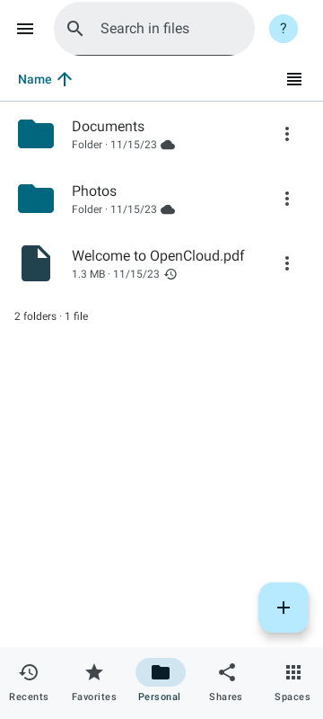
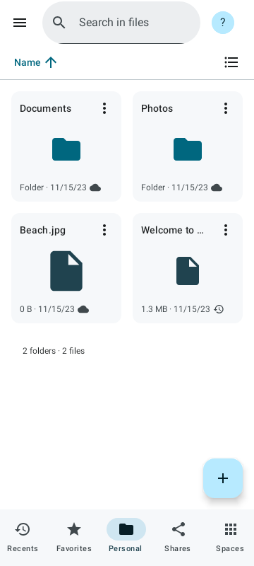
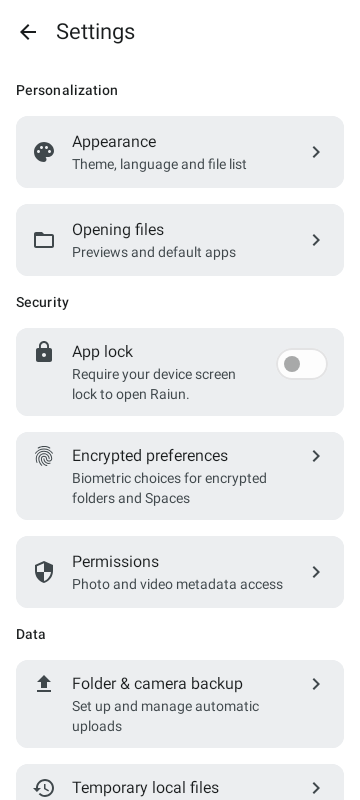
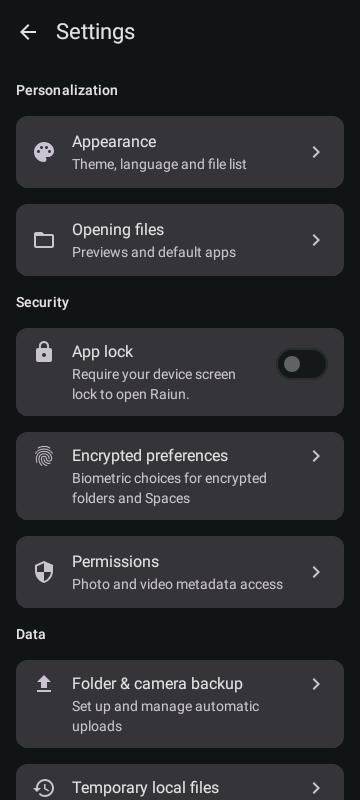
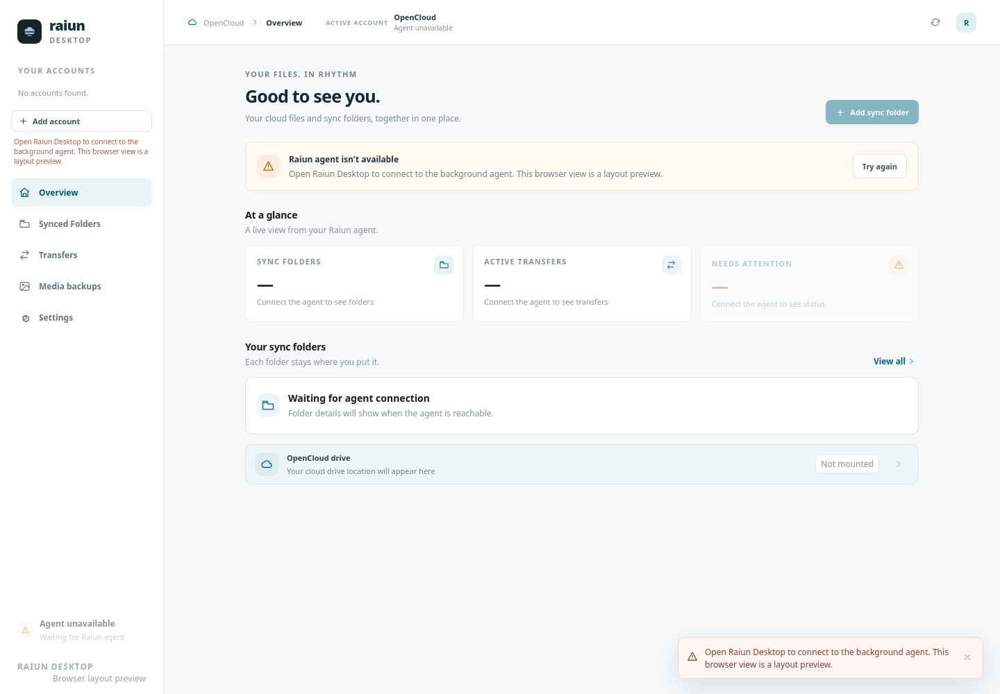
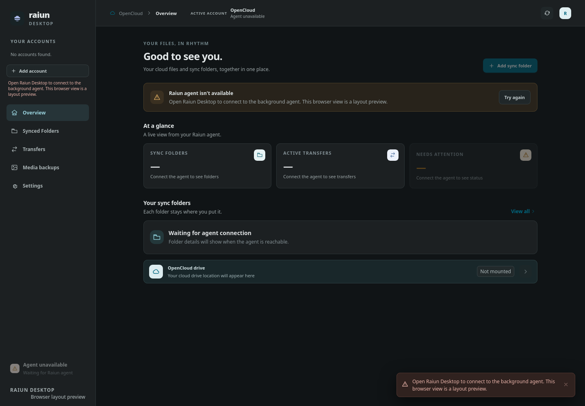

# Raiun

Independent OpenCloud apps for Android and desktop, built around the same product and design. This is not an official OpenCloud GmbH product or supported client.

I build projects to solve problems I run into in my own life. I share them because I believe in open source and hope others can learn from them, adapt them or find them useful. Making them public does not mean they are suitable for every setup, and I can't promise a support schedule. Bug reports and feature requests are welcome so please open an issue to share problems, ideas or suggestions and help make these projects better.

## Apps

| Platform | Source and setup | Release status |
| --- | --- | --- |
| Android | [apps/android](apps/android/README.md) | [1.2.0](https://github.com/phillip9933/raiun/releases/tag/android-v1.2.0) |
| Linux Desktop | [apps/desktop](apps/desktop/README.md) | [0.7.0-beta.2](https://github.com/phillip9933/raiun/releases/tag/desktop-v0.7.0-beta.2); early beta |
| Windows Desktop | [apps/desktop](apps/desktop/README.md) | [0.7.0-beta.2](https://github.com/phillip9933/raiun/releases/tag/desktop-v0.7.0-beta.2); early beta |

Android and desktop have independent versions and release pages. Android 1.2.0 is the latest Android release. Linux and Windows share Desktop 0.7.0-beta.2; macOS is not released.

Android includes Personal files and Spaces, encrypted folders and Spaces, offline access, transfers, folder/camera backup and document scanning. See its [features and limitations](apps/android/README.md), [privacy notice](apps/android/PRIVACY.md) and [changelog](apps/android/CHANGELOG.md).

## Screenshots

Android folder browsing in list and grid views (app renders with demo files):

| List view | Grid view |
| --- | --- |
|  |  |

Android settings, rendered from the app with test data:

| Light | Dark |
| --- | --- |
|  |  |

Desktop light and dark interfaces (browser layout previews; no account connected):

| Light | Dark |
| --- | --- |
|  |  |

## Roadmap and work

Follow the public [Roadmap and work board](https://github.com/users/phillip9933/projects/3) for Android and Desktop release planning and implementation status. [Issues](https://github.com/phillip9933/raiun/issues) contain scope, acceptance criteria and verification. Release maturity and work completion are separate; see the [contribution and release policy](CONTRIBUTING.md#issues-work-board-and-release-roadmap).

## Develop

Each app owns its toolchain, dependency locks, tests and build outputs. To build Android:

```sh
cd apps/android
python3 scripts/install_offline_scanner_sdk.py
./gradlew :app:assembleDebug
```

Use JDK 21 and Android SDK 36. Open `apps/android` in Android Studio. GitHub Actions remain in the repository's `.github/workflows` directory and run Android from that same project directory. See [Contributing](CONTRIBUTING.md) and the [monorepo guide](docs/MONOREPO.md).

For Linux desktop, use Rust, Node.js/npm and the native dependencies listed in
[its setup guide](apps/desktop/README.md), then run:

```sh
cd apps/desktop
scripts/build-linux.sh
```

Desktop CI is independent of the Android SDK. Shared [branding and design
references](design/) stay at the repository root. Each app owns its native
resources and packaging.

## Releases and security

Download Android APKs and Linux/Windows desktop packages from [GitHub Releases](https://github.com/phillip9933/raiun/releases). Install a release signed with the original identity over an existing Raiun installation to preserve app data. Read the app's limitations and keep independent backups.

New releases will use platform-specific tags and assets so Android and desktop can version independently. Existing tags remain unchanged. See [Releasing](docs/RELEASING.md), [version history](CHANGELOG.md), [security reporting](SECURITY.md), [privacy](PRIVACY.md) and [third-party notices](THIRD-PARTY-NOTICES.md).

## AI usage and license

I use AI tools to help with development, including analysis, code, tests and documentation. Validation records distinguish checks actually run from checks still required. Source review and automated tests are not security certification.

Licensed under [AGPL-3.0-only](LICENSE). See [NOTICE](NOTICE); third-party components retain their own licenses and notices. The license does not grant rights to third-party trademarks.
