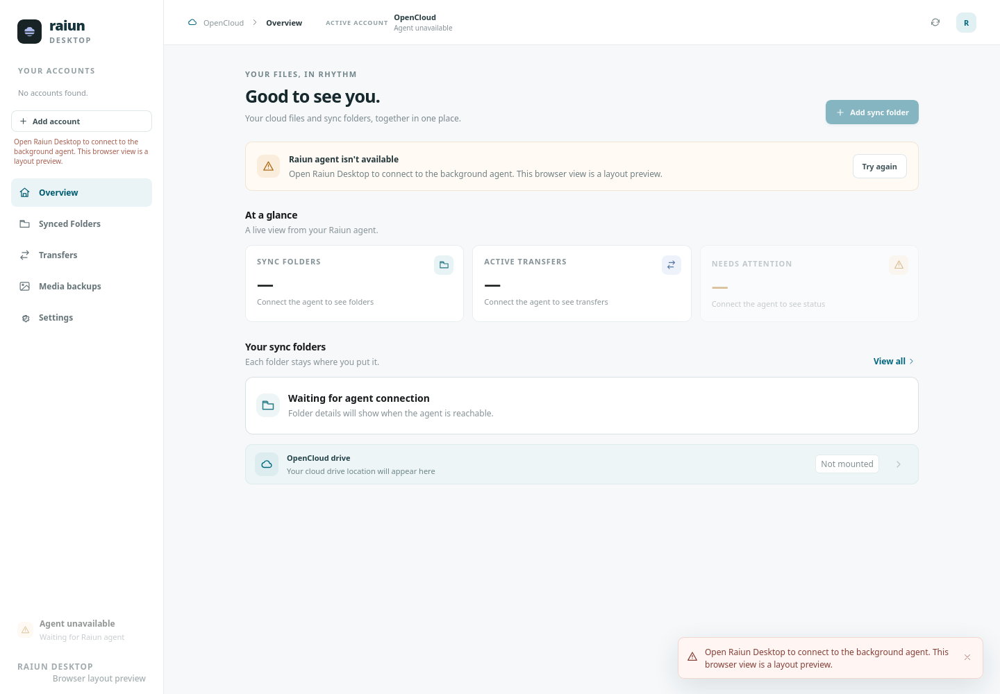
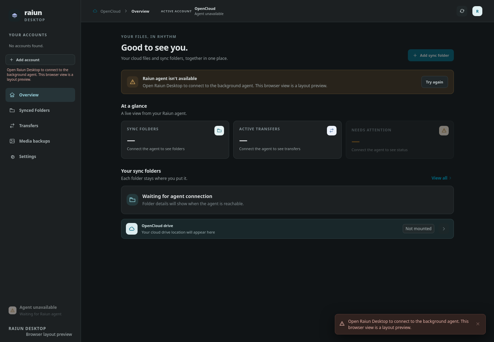

# Raiun Desktop

An OpenCloud desktop client for Linux and Windows with a Rust background engine, a Tauri
tray/settings UI, and a separate filesystem root per account:

```
OpenCloud/
  Personal/
  Spaces/
    Team space/
```

**Desktop 0.8.0 Beta for Linux x86_64.** Download the GUI AppImage or standalone CLI archive from the [Linux beta release page](https://github.com/phillip9933/raiun/releases/tag/desktop-v0.8.0). Windows remains on [0.7.5 Beta](https://github.com/phillip9933/raiun/releases/tag/desktop-v0.7.5); this Linux release does not contain a Windows update. macOS is not released. Desktop and Android keep independent versions in this monorepo.

The numeric 0.8.0 release stays on the Beta update channel. Compatible installed Linux clients can explicitly download/install verified updates; see [Desktop updates](docs/DESKTOP-UPDATES.md) for channels and trust. Upgrade GUI, Agent and CLI together. Keep existing account, settings and recovery directories; older Agents cannot open upgraded caches.

See [authentication and compatibility](docs/AUTHENTICATION.md) for GUI and
headless CLI authentication and validation limits.

The app provides an OpenCloud drive, folder sync, offline caching, encrypted file access, account controls, transfers and recovery. The Sync Folders workspace presents ordinary sync folders and upload-only media folders together; Sync Folders supports two-way and one-way directions, Photos/Videos filters and editable exclusions. Settings include Light/Dark/System themes, per-account colors, account rename/removal/restore and grouped storage, network and security controls. Windows uses an in-place installer upgrade by default. Media import runs remain bounded by documented stability, file-size and conflict rules; source files stay in place and older cloud versions are not automatically retained. See the [beta changelog](CHANGELOG.md), [Sync Folders guide](docs/SYNC-FOLDERS.md) and [acceptance records](docs/MVP-ACCEPTANCE.md).

## Screenshots

Browser layout previews of the Desktop interface; no account connected. These show the themes, not a running native connection.

| Light | Dark |
| --- | --- |
|  |  |

## Headless CLI

Linux 0.8.0 includes a separate CLI/Agent archive. GUI and CLI share one Desktop
checkout and upload implementation while retaining separate account/state and
credential policies. Installing this release does not change saved sign-in or
enable startup services.

`raiun drive` controls a separate mount-only agent with isolated state and account
routing. Its package contains only the Rust CLI and agent; see [Linux setup](docs/HEADLESS.md),
[Windows setup](docs/HEADLESS-WINDOWS.md) and [startup](docs/HEADLESS-STARTUP.md).
Browser PKCE prints a URL for manual opening, including the documented SSH forwarding
flow; app-token sign-in uses hidden input or private stdin. Folder sync, media jobs
and vault operations remain disabled in headless mode.

Without a headless config, sign-in is memory-only and restart requires fresh login.
Choosing configured operation opts into its policy: `remember_login` and `auto_mount`
default to `true` in that explicit config; use `--no-remember-login` and
`--no-auto-mount` during config creation, or set them to `false`, to disable them.
Remembered headless credentials use private plaintext files on Linux and isolated
current-user DPAPI on Windows. Startup registration is a separate explicit action.
See [privacy](PRIVACY.md#headless-cli-candidate) before enabling persistence.

The setup guides retain scoped acceptance records. Linux publication reuses the completed preserving upgrade/startup and ordinary GUI/CLI file-workflow checks; it does not claim exhaustive boot startup, confirmed-discard execution or Windows acceptance.

## Components

- `raiun-core`: configuration validation, cloud backend contracts, namespace names.
- `raiun-opencloud`: Graph discovery and conditional streaming WebDAV operations.
- `raiun-engine`: SQLite inventories, baselines, verification, and transfer history.
- `raiun-agent`: local control socket, background scheduler, browser sign-in, keyring.
- `raiun-fuse`: Linux filesystem adapter with local write spooling.
- `raiun-cli`: isolated headless `drive` controls, offline configuration commands,
  bounded media-destination preview from an explicit JSON manifest and local
  `media-scan`. The preview and scan commands do not import, rename or upload files.
- `raiun-headless`: strict nonsecret configuration and isolated persistence policy
  shared by the CLI and its mount-only agent.
- `desktop-shell`: Tauri 2 native tray with account settings, the unified Sync Folders
  workspace, conflict review, saved-copy recovery and transfers.
- `raiun-vault`: streaming vault encryption/decryption, scoped unlock lifecycle,
  and portable directory validation. Explicit encrypted folder pairs use a
  separate verified backend; ordinary sync and the on-demand mount retain
  encrypted-area guards. See [encrypted sync](docs/ENCRYPTED-SYNC.md).

## Shared visual design

The [Raiun design reference](../../design/raiun/DESIGN-SYSTEM.md) defines neutral
information panels, semantic status colors, account identity, light/dark tokens
and a per-platform review scorecard. Use its [component catalog](../../design/raiun/reference.html)
for comparison. Run `python3 scripts/design-tokens.py --check` from this directory;
regenerate Desktop CSS and the catalog token embed with `--write` after token edits.
Token checks do not certify runtime accessibility, keyboard operation or reflow.

## Build and test

Install Rust stable, Node.js/npm, GTK 3, WebKitGTK 4.1, Ayatana AppIndicator,
FUSE 3, Zenity, and Secret Service tools. On Arch Linux the additional UI packages are
`webkit2gtk-4.1`, `libayatana-appindicator`, and `zenity`; keyring access uses `secret-tool`.
Zenity is required for confirmation dialogs with the Linux dialog backend.
A running, unlocked desktop Secret Service is required to persist credentials.

```
cargo fmt --all --check
cargo clippy --workspace --all-targets --locked -- -D warnings
cargo test --workspace --locked
scripts/build-linux.sh
```

The build script produces a portable directory and tarball under `target/`.
Extract the tarball and run its `install.sh` to install to the current user's
application directory. Dependencies remain system packages; the tarball is not
an AppImage and does not bundle GTK/WebKit. No installation, autostart, mount,
or sign-in occurs just by compiling it.

New Linux bundles include an inert `manifest.txt` with UTC build time, Git
commit/dirty status, and hashes of the three executables and icon. The installer
validates the fixed manifest and staged payloads before replacing files, then
installs the manifest beside them. `bash scripts/test-linux-installer.sh` tests
rejection and preservation using temporary synthetic bundles. These unsigned
hashes detect corruption or mismatch; they do not authenticate the publisher.
Commit plus dirty status is not a reproducible identity for uncommitted source.

## AppImage

An x86_64 AppImage is provided with the [Linux 0.8.0 Beta release](https://github.com/phillip9933/raiun/releases/tag/desktop-v0.8.0). It targets Ubuntu 24.04-era systems (glibc 2.39 or newer), bundles the interface and background agent, and uses the same existing account/settings locations. Cloud-drive mounting still needs system FUSE 3; persistent sign-in needs a desktop keyring. See [AppImage setup](docs/APPIMAGE.md) for launch, startup and integration details.

## Development operation

`raiun-agent serve` runs the per-user agent. The installed shell starts its
sibling agent if needed. Agent state defaults to
`$XDG_STATE_HOME/raiun-desktop` (otherwise `~/.local/state/raiun-desktop`);
`RAIUN_STATE_DIR` overrides it for isolated tests. Secrets reside in the OS
keyring, not settings JSON or SQLite. `raiun-agent request '<JSON>'` is a local
control diagnostic; never send credentials through it.

Folder-pair deletion propagation is currently conservative: missing baseline
items and conflicting edits require attention. The cloud mount is a separate
projection; local folder pairs cannot overlap it. `media-preview` is a bounded offline CLI planner. The unified Sync Folders workspace also configures recurring upload-only media jobs. Each source stays in place; staged stability checks and explicit conflict review govern uploads. Full native media restart acceptance remains outside the claims made here.

Read [architecture](docs/ARCHITECTURE.md),
[language decision](docs/LANGUAGE-DECISION.md), and
[implementation status](docs/IMPLEMENTATION.md) for rationale and limitations.
See the [desktop feature roadmap](docs/DESKTOP-FEATURE-ROADMAP.md),
[media design](docs/MEDIA-SYNC-DESIGN.md), and
[encryption interoperability limits](docs/ENCRYPTION-INTEROP.md) for planned work.


### Linux 0.8.0 Beta

This Linux GUI and CLI beta includes shared parallel ordinary uploads, fewer redundant successful-upload readbacks, clearer Transfers tabs and review actions, and compact Settings. Normal file-manager operations remain the common workflow; dedicated folder-upload and whole-folder deletion controls are deferred.

Account removal preserves local files and recovery copies while revoking saved sign-in and remembered vault-password access. Eligible stopped ordinary uploads offer a separate confirmed local-copy discard action after unmounting; it never deletes the cloud file. Other retained, active or unsupported recovery records are refused. See the [changelog](CHANGELOG.md) and [implementation status](docs/IMPLEMENTATION.md) for scope and limits.
