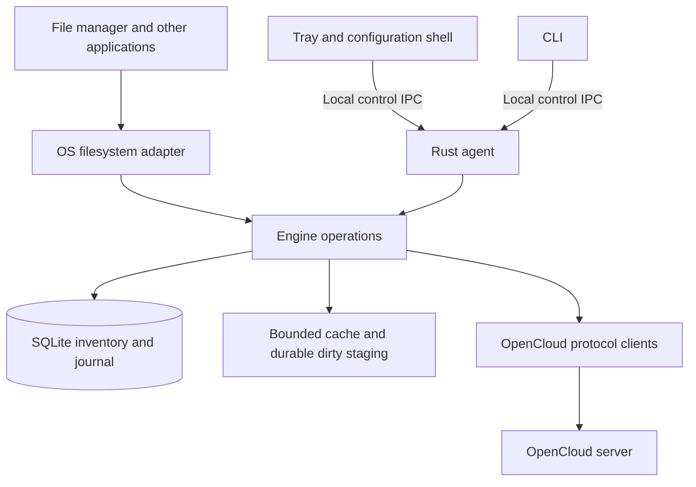

# Raiun Desktop architecture

Status: accepted direction and target architecture; implementation status is
tracked separately. Updated 10 October 2026.

Raiun Desktop is a lightweight OpenCloud companion that keeps existing local folders synchronized and exposes cloud content through the operating system's file manager. Linux is the first release target, Windows follows, and the architecture preserves a native macOS path. One desktop repository produces the platform packages. The Android application remains a separate project.

Rust owns the resident engine. The configuration interface is a separate
client of that engine. The implementation has grown beyond the initial
configuration and namespace foundation: protocol, engine, agent, Linux FUSE,
CLI, and Tauri shell components now exist, with Linux integration checks
recorded in [implementation status](IMPLEMENTATION.md). This document remains
the target architecture and does not imply that every proposed platform or
release behavior is complete.

## Product contract

The target Linux MVP includes a tray icon, background operation, sign-in,
folder-pair setup and options, one transfers view, and a usable cloud
filesystem. Closing the configuration window should not stop synchronization;
manual close/tray interaction still needs acceptance. OpenCloud's web
application remains the place for rich browsing, collaboration, and
administration.

Users select existing folders wherever they live on supported local volumes. Files need not move beneath the cloud root. Each pair maps one local directory to a directory within a personal or project Space. Two-way synchronization is the main mode; upload-only and download-only modes have explicit deletion policies rather than ambiguous mirror semantics.

Each configured account has its own OS cloud entry and independent cloud root:

```text
OpenCloud — account A
├── Personal
│   └── the user's personal files and folders
└── Spaces
    ├── Design
    └── Family

OpenCloud — account B
├── Personal
└── Spaces
    └── Research
```

Personal and Spaces are synthetic namespace nodes. They are not folders created on the server. Project Spaces appear underneath Spaces; the personal drive appears once, under Personal. Selecting a Space changes neither its permissions nor membership. Users can make ordinary bookmarks or shortcuts into this hierarchy. Separate per-Space OS registrations are out of scope.

Other applications must be able to enumerate, open, create, save, rename, and delete supported files through ordinary filesystem APIs and file dialogs. An Explorer sidebar link that only opens a web page does not satisfy the requirement. Uncached content downloads on demand. Being visible does not mean a file is available offline. The provider reports read-only permissions and unavailable content accurately.

Remote-folder browsing may warn when existing names are not portable to
Windows, including reserved device names, unsupported characters, trailing
dots or spaces, and sibling names that compare equal after lowercase
conversion. These notices are advisory: names stay unchanged and valid Linux
names are not rejected. Lowercase comparison is an approximation, not a full
implementation of Windows case folding, Unicode normalization, or
filesystem-specific rules.

Each account has a distinct profile, state directory, credential scope, scheduler, and cloud root; resource identity remains account-scoped. The selected account controls the settings and transfer view, but does not merge roots or change another account's sync state. Reject overlapping account roots and folder-pair roots, including canonical and ancestor/descendant aliases. Encrypted folders and Spaces, richer photo/video organization, metadata-based renaming, and additional automation are future increments. Detect encrypted areas early and block unsupported plaintext treatment.

## Language and toolkit decisions

| Area | Decision | Reason |
| --- | --- | --- |
| Resident engine and domain code | Rust | Native filesystem integration, explicit resource ownership, one headless engine across desktop platforms |
| Persistence | SQLite with a Rust adapter, explicit migrations and transactions | Large inventories and durable work belong on disk |
| Network runtime | Current provider uses reqwest's blocking client for streaming operations; a bounded async runtime remains a target for higher-concurrency work | WebDAV/TUS behavior remains our responsibility; current implementation and target are distinguished in [implementation status](IMPLEMENTATION.md) |
| Tray and configuration shell | Tauri 2 with a Rust host and a small TypeScript/HTML/CSS frontend | Cross-platform packaging and tray support; narrow UI surface independent of the engine |
| Linux provider | Rust FUSE adapter using `fuser` 0.18.0 | A real mounted filesystem is implemented and host-tested; broader desktop-session acceptance remains open |
| Windows provider | Rust adapter using Windows Cloud Files APIs and Windows bindings | Native placeholders, hydration, and Explorer integration |
| macOS provider | Swift replicated File Provider extension with a narrow Rust interface | Follow the OS extension lifecycle rather than emulate a Linux mount |

Tauri renders through platform webviews and supports tray applications. Its webview belongs to the configuration shell, never the engine. The shell starts without a configuration window; opening settings creates a webview and closing settings destroys it. Whether the platform actually releases associated webview processes must be measured. Exiting the entire shell must leave the independently supervised engine running. No Electron or bundled Node runtime is required by this proposal. See [Tauri architecture](https://v2.tauri.app/concept/architecture/) and [tray support](https://v2.tauri.app/learn/system-tray/).

The Rust decision is not a claim that JVM applications cannot scale. Kotlin would preserve more protocol implementation, but desktop reconciliation, filesystem providers, scheduling, and large-inventory processing need new work. The strongest existing assets are transfer semantics and encryption fixtures. Keep those as reference behavior and parity tests. Do not mechanically port Android's whole-tree in-memory scanning or DOM-based full-listing approach.

Windows bindings provide API access, not a completed sync provider. The
selected `fuser` dependency has passed disposable host-mount and isolated live
FUSE checks, but supported desktop-session behavior still needs acceptance.
See [Microsoft Windows bindings](https://github.com/microsoft/windows-rs) and
[fuser](https://docs.rs/fuser/latest/fuser/).

## Repository and build structure

The project container is `/home/phil/Projects/raiun-desktop`, with Git rooted in `repo/`. Versioned architecture and acceptance criteria live in `repo/docs/`. Generated deliverables and usage records belong in the container's `outputs/`; signing material remains outside Git. The Android checkout at `/home/phil/Projects/raiun/repo` is reference material, not a build dependency.

The initial two-crate workspace has since expanded into six Rust workspace
crates (`raiun-core`, `raiun-cli`, `raiun-opencloud`, `raiun-engine`,
`raiun-agent`, and `raiun-fuse`), plus the separate Tauri shell package.

The initial Cargo workspace has `raiun-core` and `raiun-cli`. Add modules when implemented, following these responsibilities:

| Planned module | Owns |
| --- | --- |
| raiun-core | Stable identities, configuration validation, reconciliation decisions, namespace rules |
| raiun-store | SQLite inventory, baselines, journals, leases, migrations |
| raiun-opencloud | Discovery, OAuth, Graph/Spaces, WebDAV, TUS, capability checks |
| raiun-engine | Scheduling, transfer execution, recovery, single-writer coordination |
| raiun-agent | Per-user headless executable and local control API |
| raiun-cli | Diagnostics and control client; current offline configuration tool |
| provider-linux and provider-windows | Native filesystem adapters and OS callback lifetimes |
| desktop-shell | Tauri host, tray menu, TypeScript settings and transfers UI |
| platform/macos | Swift extension, entitlements, bridge and packaging |

No crate imports UI code to perform synchronization. Pure core crates forbid unsafe code. Any necessary native unsafe boundary belongs in a small adapter crate with explicit lifetime and cancellation tests. Desktop packages are built on platform runners; one repository does not imply all signed installers can be built on Linux. Start with Linux development binaries, then Debian/RPM packages, Windows installer packages, and a macOS app bundle/DMG containing its extension. Signing, notarization, updater trust, and provider registration are release work, not ordinary build side effects.

## Runtime ownership and process boundaries



On Linux and Windows the provider adapter may run inside the agent, avoiding a serialization hop for every read. The code boundary remains separate so a later crash-isolated adapter is possible. Blocking filesystem callbacks must never block the async scheduler or hold database transactions while waiting on a network response. Callback cancellation, deadlines, backpressure, and application-visible errors are first-class inputs.

The agent is the single authority for synchronization state and remote mutations. Folder-pair work, cloud-drive writes, hydration, and later media jobs all enter the same scheduler. The tray/UI observes this state; it does not maintain a second transfer queue or edit the database directly.

Control IPC uses per-user Unix sockets on Linux/macOS and ACL-restricted named pipes on Windows. Authenticate the local peer, version messages, bound message sizes and event history, and use request IDs for retries. UI messages contain typed operations such as ListPairs, PreviewPair, AddPair, PauseScope, ListTransfers, and RetryTransfer. Do not expose arbitrary shell execution or raw database access. Tokens and vault secrets do not enter the webview. File bodies stay out of JSON control messages.

Use a per-user supervisor, not a privileged system daemon: Linux user service/session startup, Windows user-session startup, and an appropriate macOS launch/extension design. Logout and suspend are expected. Startup recovers durable jobs before accepting new writes. Only one agent may own an account's state directory. Graceful quit persists outstanding operations and safely disconnects providers; ordinary window close is not Quit.

The current CLI edits an offline JSON file. When a resident agent exists, mutations must route through it or refuse while it owns configuration. Do not permit CLI and agent to become independent writers.

## Cloud namespace and platform behavior

Resource identity is `(account_id, space_id, resource_id)`, with provider item IDs derived from stable identity rather than display paths. Persist names and aliases separately. Sanitize unrepresentable local names, disambiguate collisions, and keep mappings stable across discovery order. A remote rename is an explicit mapping update. The current pure namespace helper offers deterministic initial labels; production mount names must be persisted so adding another Space cannot unexpectedly rename an existing path.

Synthetic Personal and Spaces roots cannot be renamed, uploaded, or deleted. Namespace enumeration discovers membership and permissions, then loads individual directories lazily. A directory listing is complete only after every page or response portion has validated successfully. Do not assume WebDAV servers support pagination. For very large depth-one XML responses, stream into a staging table, impose response/time limits, and publish only after successful completion. If limits are exceeded, preserve the old snapshot and surface an actionable error; never infer missing files from a partial result.

Linux uses FUSE for real filesystem access. Sidebar visibility is a separate file-manager integration concern; verify supported KDE/Dolphin and GNOME/Files environments, including Wayland. A working mount alone does not promise identical bookmarks, icons, or tray behavior in every desktop environment. See [Linux FUSE documentation](https://docs.kernel.org/filesystems/fuse/index.html).

Windows uses a registered Cloud Files root. Native placeholders expose files before hydration; pinning and residency are distinct from sync completion. Cloud Files currently depends on NTFS. Arbitrary folder pairs are independent normal local folders and are not automatically converted to placeholder roots. The provider must implement conflicts, recovery, and changes itself; Microsoft's example is not a production sync engine. See [Cloud Files architecture](https://learn.microsoft.com/en-us/windows/win32/cfapi/build-a-cloud-file-sync-engine).

macOS uses one File Provider domain per account with Personal/Spaces represented inside each domain. OS-managed provider paths must be respected; do not promise an arbitrary user-selected mount location on macOS. Swift handles extension lifecycle and native item representations. A bridge may call Rust library code, but there must be an explicit owner for mutable state. Prototype extension-to-agent communication and sandbox access before committing to that topology. If direct IPC is unsuitable, use an app-group durable request mailbox with defined ownership rather than two independent reconciliation engines. See [Apple replicated File Provider](https://developer.apple.com/documentation/fileprovider/replicated-file-provider-extension).

The full MVP requires writable cloud-file access, pin/unpin, error reporting, and recovery on its release platform. A read-only mount is a useful internal milestone but is not the promised MVP. Cross-Space moves are copy-and-verify followed by a separately authorized delete, not assumed atomic server moves. Do not claim POSIX locking, hard links, device files, or transactional multi-file database behavior. Reject unsupported special files clearly. Application save-through-temporary-file and rename patterns are mandatory compatibility tests.

## Folder pairs and reconciliation

A pair includes account, stable Space ID, remote directory identity/path, canonical local root and volume identity, direction, deletion policy, filters, scheduling policy, and pause state. Schema version one currently records only the basic mapping and direction; add explicit migrations before introducing the remaining settings. Server discovery will replace manually entered Space IDs in the user interface.

Reject duplicate IDs, local ancestor/descendant overlaps, remote ancestor/descendant overlaps within the same Space, and any pair intersecting the provider root, cache, or agent state. Resolve symlink aliases and volume case behavior. Recheck identities when executing operations because a validation-time path check cannot prevent later path replacement. Detect removable volume disappearance as unavailable, not an empty directory. Initially reject symlink traversal inside pairs; future opt-in behavior requires loop, escape, and duplicate-ownership rules.

New pairs begin with a preview comparing both sides. An initial absence is not a deletion, because no shared baseline exists. Preserve conflicting content and ask for a resolution. Never select a winner solely from wall-clock timestamps.

| Since the last verified baseline | Planned behavior |
| --- | --- |
| Only local content changed | Upload conditionally against the recorded remote revision |
| Only remote content changed | Download to staging, verify, then replace the unchanged local version |
| Both changed identically | Verify equivalence and advance the baseline |
| Both changed differently | Preserve both versions and create a conflict requiring a policy or user decision |
| Delete on one side, other side unchanged | Apply the pair's explicit deletion policy and safety checks |
| Delete on one side, edit on the other | Preserve the edit and surface a conflict |
| Permission loss, failed listing, offline volume | Pause affected scope; do not propagate deletions |

Two-way mode may propagate verified deletions after onboarding explains the behavior. Upload-only and download-only start with deletion propagation disabled. Enabling mirroring is a distinct explicit setting. Large deletion batches require a reviewable plan and user acceptance before execution. Unpairing removes the relationship, not local or remote files.

Watchers provide hints, not the durable truth. Coalesce duplicate events, recover from overflow with bounded rescans, and reconcile periodically. Record scan generations and commit completeness atomically. Store inventories and work queues on disk; read them in pages. Use size/mtime as hints and content checks when identity is uncertain. Detect renames from reliable identities when available; ambiguous cases preserve data rather than invent a move.

Folder pairs and cloud-drive projections may reference the same remote objects. They share resource locks, revisions, and transfer deduplication. Neither watches the other's cache. A successful write creates a new verified remote revision, then updates projections and pair baselines without re-uploading the same content.

## Transfers and crash recovery

Every operation has a durable ID, origin, resource identity, expected revision, source generation, byte progress, retry policy, and verification state. States distinguish queued, running, retry-wait, paused, awaiting-authentication, conflict, verifying, completed, cancelled, and failed. A transfer reaching 100 percent bytes is still verifying until the destination outcome is established.

Persist the operation before issuing a remote mutation. Use conditional writes and server-advertised capabilities. When a response is lost, inspect the destination and session state before retrying; do not repeat an unconditional replacement. TUS resume requires validating upload identity and offset. Download resumes require validated revisions and range responses. If a server cannot provide a needed safe precondition, block that operation or require an explicit conflict decision.

Provider writes first land in durable local staging. A successful local flush means data has been persisted locally, not uploaded. Protect dirty bytes from cache eviction. Publish remote success and update the baseline only after verification. Keep disk reservations bounded; report insufficient space to the writing application rather than accepting data that cannot be retained. Recovery replays the journal, checks remote outcomes, and requeues safely.

Cancellation stops future work and releases clean temporary data. It does not silently discard the only copy of a dirty file. Destructive discard is a separate action. Rename and delete operations carry ordering dependencies so a queued upload cannot recreate an intentionally removed file.

Interactive hydration outranks bulk background work, with fairness so background sync still progresses. Initial target: four transfers total, separate small metadata concurrency, bounded per-transfer buffers, and a configurable rate limit. Priorities may change; the invariant is bounded concurrency and a disk-backed queue.

## Cache and resource budgets

Keep metadata, clean cached content, pinned content, and dirty staging separate. Clean content can be evicted by policy. Pinned and dirty data cannot. Track used, reserved, and reclaimable bytes; a configured clean-cache quota is not a guarantee that dirty user writes fit in the same space. Show the distinctions in settings.

File size must not determine resident buffer size. Inventory size must primarily affect disk storage and scan duration, not a retained in-memory object for every file. Encryption and hashing stream bounded chunks. Hash worker counts and simultaneous vault key derivations need their own limits. Full directory listings, thumbnails, and UI transfer history must also be bounded.

Provisional Linux engineering targets, to be measured rather than advertised: engine RSS below 150 MiB at steady idle with a one-million-entry indexed fixture, below 300 MiB during four sustained unencrypted transfers, and near-zero idle CPU after scans settle. These are design gates, not current results. Count SQLite caches, native allocations, thread stacks, and provider code. Report the tray host and all webview child processes separately and as an aggregate; do not hide memory costs by moving them into helpers. Record workload, machine, scan state, and cache state with every measurement. Adjust targets only through an explicit design decision.

## Design language and user flows

Use Raiun's existing cloud-crest identity and calm colors, adapted to desktop interaction rather than copying phone screens. The product name is Raiun Desktop; OpenCloud identifies the connected service and the cloud-drive entry. Brand assets may be reused with their existing provenance retained.

| Token | Light | Dark |
| --- | --- | --- |
| Background | #F6F8FA | #101416 |
| Content surface | #FFFFFF | #1C2022 |
| Primary action | #00677F | #8AD3E3 |
| Main text | #191C1D | #E0E3E5 |

Use system fonts, a 4 px spacing scale, compact labeled controls, restrained 8 px corners, and OS window decorations. Aim for familiar desktop density with keyboard focus, accessible names, scalable text, high contrast, and reduced-motion support. Status must use text and symbols, not color alone. Native file dialogs select local folders; remote pickers show Personal and Spaces using live permissions. No permanent in-app file browser is needed.

The tray menu shows overall state, Open cloud folder, Open web, Transfers, Sync folders, Pause/resume, Settings, and Quit. When a desktop has no tray support, retain a discoverable application entry and status window; do not hide the only control surface. Pausing background work must explain whether requested file opens can still hydrate; expose a separate explicit offline policy.

Sync folders shows local path, remote location, direction, last verified activity, and actionable problems. Add pair selects both ends, previews initial changes, explains conflict/deletion behavior, then starts. Options include filters, direction, network limits, and scheduling as implemented. Never expose implementation identifiers in the eventual end-user flow.

Transfers combines folder sync, provider uploads/downloads, and later media tasks. Provide Active, Needs attention, and History filters, per-item origin/direction/progress, retry/pause/cancel controls, and aggregate throughput. History is paginated and retained for a bounded period. Failures include a concrete recovery action without dumping HTTP stack traces into the main UI.

## Authentication and security boundaries

Use the system browser for OIDC authorization with PKCE and validated redirect/state handling. Store refresh tokens in platform credential storage, never the JSON config, inventory, logs, or webview. Serialize refresh operations. Server URLs and advertised endpoints need origin and redirect validation; do not forward authorization to arbitrary redirected hosts. TLS verification remains enabled.

A UI window receives narrowly scoped capabilities and typed engine operations. Render file and Space names as text. The web application opens in the user's browser rather than loading remote pages in a privileged settings webview. See [Tauri capability controls](https://v2.tauri.app/security/capabilities/).

Permissions and membership are revalidated on remote errors and discovery changes. Losing access makes the projection unavailable; it is not an instruction to delete unrelated local data. Account removal needs a clear policy for cached content and pending writes. Logs should use operation IDs and redacted metadata, with an explicit diagnostic export flow.

## Future encryption and media work

Encryption is a storage-boundary implementation behind the same logical resource and transfer interfaces. Preserve OpenCloud's actual vault format, filename rules, integrity behavior, and compatibility fixtures. Do not introduce a desktop-only encrypted format. Reuse Android and upstream known-answer fixtures in Rust tests; use established cryptographic implementations rather than inventing primitives.

Locked vaults expose an intentional locked state and cannot fall back to ordinary raw uploads. Encrypted Spaces remain under the single Spaces hierarchy. Encrypted folders remain within their parent hierarchy. Unlock sessions, key storage, metadata exposure, and cache encryption are explicit policies. A vault lock cannot guarantee removal of plaintext already handed to another application; provider/open-handle behavior must reflect that limitation. Read-only interoperability precedes writes and offline encrypted caching.

Media jobs run through the existing queue. Metadata extraction and date-based naming are separate from file transport. Define date-source precedence, timezone interpretation, collision behavior, repeat-run idempotency, sidecar handling, and whether renaming affects the destination only. Preview transformations before applying them. Original media remains intact unless the user selects a destructive policy. Video extraction processes and thumbnail work have separate CPU/memory limits.

## Delivery sequence and acceptance

| Stage | Deliverable | Exit evidence |
| --- | --- | --- |
| Foundation | Separate repository, architecture, core models/validation, offline CLI, CI | Local Rust gates and synthetic filesystem tests; no sync claims |
| Engine proof | SQLite journal, protocol discovery, streaming transfers, bounded inventory, Linux filesystem experiment | Crash/retry tests, representative resource measurements, real application file opens |
| Linux alpha | Background agent, tray/setup/transfers, writable cloud drive, folder reconciliation | End-to-end server fixtures plus supported desktop sessions; conflict, disk-full, disconnect and permission-loss tests |
| Linux integration MVP | Agent, tray/setup/transfers, writable cloud filesystem, folder reconciliation, conflict recovery, and installation documentation | Server-backed operations and recovery checks; supported-session manual lifecycle and actual login-autostart acceptance remain open |
| Windows alpha | Cloud Files adapter, Explorer registration and installer | Native Windows tests and user testers; never infer support from Linux tests |
| Post-MVP hardening | Offline pinning, signed/reviewed release process, measured resource budgets | Separate product and release acceptance; these are not prerequisites for the current Linux integration MVP |
| Later | Encryption, media workflows, macOS | Separate compatibility gates; macOS extension spike before promising a release |

The owner's discussion mentioned roughly a month as an aspiration. This design does not turn that into a delivery promise: writable virtual filesystems and safe bidirectional reconciliation are substantial work. Implement the riskiest engine/provider behavior before polishing settings screens.

Required scenarios include 100,000 and one-million-entry inventories, a single unusually large directory, multi-gigabyte files, application atomic-save patterns, Unicode/case collisions, unchanged idle operation, watcher overflow, revoked membership, unplugged volumes, 401/403/404/412/429 responses, interrupted uploads, full disk, process death before/after remote commit, and upgrade recovery. Real Windows/macOS validation remains required even when shared Rust tests pass on Linux.

## Decisions that remain to validate

The Rust engine, separate repository, single namespace, independent UI, Linux-
first order, and `fuser` 0.18.0 are settled. The process-level Tauri background
startup and second-launch behavior are verified; manual close/tray lifecycle
and real desktop-login autostart remain unverified. Supported server versions,
broader native startup/installer behavior, and the macOS extension bridge still
need targeted experiments. Each experiment must update this design and the
implementation ledger rather than quietly expanding scope or claiming
untested support.

The source requirement is the owner's [OpenCloud discussion comment](https://github.com/orgs/opencloud-eu/discussions/1426#discussioncomment-18805465), refined in this conversation to include a single OS-visible cloud root and future macOS compatibility. Android implementation references include `core/network`, `core/sync`, `core/crypto`, and `docs/ENCRYPTED-VAULTS-PLAN.md` in the sibling Raiun checkout; they are behavioral references and must not be modified by desktop work.
